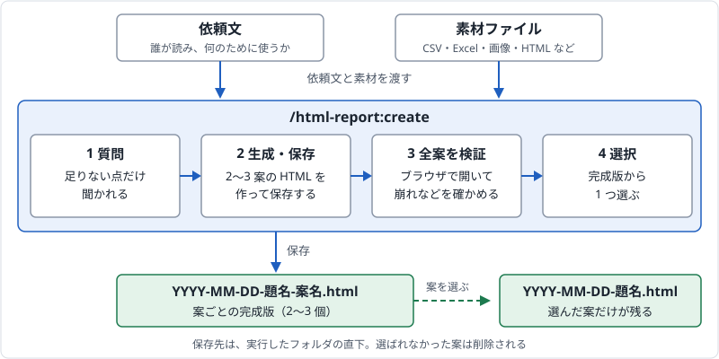
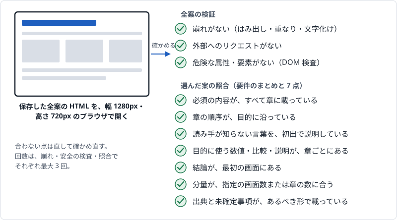

# html-report

依頼と素材から、デザインされた HTML レポートを 1 ファイルで作る Claude Code プラグイン。CSV やメモをもとに、読み手に合わせたレポートを作りたい人向け。

```
/html-report:create 先月の売上 CSV（C:\data\sales.csv）を、経営会議向けのレポートにして
```

## 機能

依頼文と素材ファイルを渡すと、確認まで済んだ HTML レポートが 1 つできる。



| 項目 | できること | できないこと |
|---|---|---|
| 出力 | 1 ファイルで完結する HTML を作る。 | PDF・PowerPoint を作る。他で作った既存の HTML を編集する。作ったレポートの修正の支援。 |
| 表示 | PC の画面（幅 1280px）で読める形にする。 | スマートフォンの表示と印刷に合わせる。 |
| 構成 | 縦に続く 1 つのレポートを作る。 | 複数ページのサイトや、フォーム送信を作る。 |
| 大きな CSV | 1000 行を超える CSV は、集計・要約した結果を載せる。 | 1000 行を超える CSV の全件を載せる。 |

素材の形式ごとの扱いは、[docs/materials.md](docs/materials.md) に書く。

## 導入方法

次がそろっていること。

- Windows 11（Windows 専用）
- Claude Code（動作確認は 2.1.328。必要な最低のバージョンは未確認）
- Playwright MCP（ブラウザを操作して、作った HTML を確かめる部品。下の手順 2 で入れる）
- Node.js 20 以上（Playwright MCP の要件。動作確認は 24.13.1）
- ネットワーク接続（Playwright MCP の取得と、`/html-report:doctor` の最新バージョンの確認に使う）
- Chrome または Edge（Playwright MCP が HTML を開くために使う）
- `artifact-design` スキル（Claude Code に同梱。`/skills` の一覧にあること）
- Git（任意。オフラインで入れるときの clone だけに使う）
- Python 3（任意。1000 行を超える CSV の集計に使う）
- `dataviz`・`artifact-diagramming` スキル（任意。あれば、グラフと図をその指針に沿って描く）

Edge だけのときは、手順 2 のコマンドの末尾に `--browser msedge` を足す。`/html-report:doctor` は、ブラウザの有無を点検しない。`artifact-design` が一覧にないときは、Claude Code を最新のバージョンに更新して開き直す。

### 1. プラグインを入れる

Claude Code の中で実行する。

```
/plugin marketplace add asama0101/html-report
/plugin install html-report@html-report
```

### 2. Playwright MCP を入れる

注意: `playwright` がすでに登録されていると、次のコマンドは「already exists」で失敗する。

先に `claude mcp list` で、`playwright` の行に `--allow-unrestricted-file-access` があるか確かめる。あれば、この手順は要らない。なければ、`claude mcp get playwright` で設定を控え、`claude mcp remove playwright -s user` で消す。戻すときは、控えた設定で `claude mcp add` する。

シェルで実行し、Claude Code を再起動する。

```
claude mcp add -s user playwright -- npx @playwright/mcp@latest --allow-unrestricted-file-access
```

`--allow-unrestricted-file-access` は、作った HTML を `file://` で開くために必要。`@latest` は、最新のバージョンを使う（動作確認は 0.0.86）。

### 3. 環境を点検する

```
/html-report:doctor
```

項目ごとに `[OK]`・`[NG]`（必須が足りない）・`[任意]`・`[情報]`（バージョン）の行が出る。`[NG]` の次の行に、対処が出る。

### オフラインで入れる

ネットワークのある環境で、リポジトリを取得する。取得には Git を使う。

```
git clone https://github.com/asama0101/html-report.git
```

1. ネットワークのある環境で取得したリポジトリを、媒体で持ち込む。
2. `/plugin marketplace add <持ち込んだリポジトリのパス>` を実行する。
3. `/plugin install html-report@html-report` を実行する。

注意: プラグインは、持ち込んだフォルダを参照する。入れたあとにフォルダを移動すると、プラグインの一覧に「failed to load」と出て、使えない。元の場所に戻すと、使えるようになる（削除したときも同じと推測。未検証）。

Playwright MCP（手順 2）の取得にはネットワークが要る。ネットワークのない環境で使えるかは未検証。

### 更新とアンインストール

更新は、`/plugin marketplace update html-report` と `/plugin update html-report@html-report` を実行して、Claude Code を再起動する。アンインストールは `/plugin uninstall html-report@html-report`。

アンインストールしても、作ったレポートと、別に入れた Playwright MCP は残る。Playwright MCP を消すときは `claude mcp remove playwright -s user` を実行する（ほかの用途で使っていれば消さない）。

## 使い方

次の依頼で、レポートが 1 つ保存される。分かっている項目は、聞かれない。

```
/html-report:create 先月の売上 CSV（C:\data\sales.csv）を、経営会議向けのレポートにして
```

実行すると、次の順で進む。

1. 環境を確かめる。使えないものがあれば、HTML は作らずに止まる。
2. 依頼文に書いたファイルを読む（CSV・Markdown・テキスト・画像・XLSX・PPTX・HTML など。読めるのは、利用可能なスキルやツールで読める範囲）。読めなかったファイルは、読めなかったと伝えられ、読めた素材だけで続く。
3. 目的・読み手・必須の内容・分量のうち、分からないものだけが質問される。必須の内容が素材にないときは、内容を伝える・外す・「素材なし」と書いて載せる、のどれにするかも聞かれる。
   要件のまとめが画面に出て、「このまま作る／直す」を聞かれる。
4. 実行したフォルダ直下に、デザインの異なる完成版が 2〜3 案、`YYYY-MM-DD-題名-案名.html` で保存される。数値と必須の内容は同じで、デザインと章立て（目的に沿った並び）が案ごとに違う。同じ名前があれば、上書きしてよいか聞かれる。「いいえ」なら、連番の別名（`-2` など）で保存される。
5. 全案の HTML が開かれ、崩れと外部へのリクエストと DOM の確認が行われる。直す回数は、1 案につき最大 3 回。
   ページの読み込みが 30 秒で終わらないときは、止まる。途中で、ブラウザの操作やファイルの書き込みの承認を求められることがある。許可して進める。
6. 完成版がブラウザで開く。案の名前から 1 つ選ぶと、選んだ案に、要件との照合（必須の内容・結論の位置・分量など）が行われ、選ばれなかった案は削除されて（削除したファイルは元に戻せない。残したい案は、選ぶ前に別の場所へコピーする）、`YYYY-MM-DD-題名.html` が残る。合わないときは「その他」で伝えると、全案が作り直される（初版の案の選び直しで、完成後の修正の支援ではない）。選ばずに終わったときは、全案が残り、保存先と削除するコマンドが伝えられる。
7. 完了報告が出る（下の例）。

```
保存先: C:\work\2026-11-10-先月の売上.html
要件との照合: 必須の内容 3 件をすべて載せた。分量は、指定 2 画面に対して 2.4 画面。
選んだ案: 紺と白の落ち着いた案（全 3 案）。
検証: 幅 1280px を確認。表の右端が切れていたため、列の幅を狭めた。
```



レポートの最後には、読んだ素材のファイル名（出典）が書かれる。素材がなく「素材なし」と書いた項目や、読めなかったファイルは、「未確定事項」としてまとめられ、出典の直前に置かれ、本文の該当箇所にも「未確定」の印が付く。

素材の内容（機密情報を含む）は HTML にそのまま入る。共有する前に確かめる。

## 困ったとき

### 「使えないもの」が伝えられ、HTML が作られない
OS・Playwright MCP・`artifact-design` のどれかが使えない。`/html-report:doctor` を実行し、`→` の行に従う。

### 検証で、保存した HTML を `file://` で開けず止まる
Playwright MCP が `file://` を開けない設定になっている。`claude mcp list` で、`playwright` の行に `--allow-unrestricted-file-access` があるか確かめる。なければ、導入方法の手順 2 をやり直す。

### 検証で、ページの読み込みが 30 秒で終わらず止まる
完了報告に、開けなかったことが書かれる。HTML は保存済みなので、ブラウザで直接開いて確かめる。

## ライセンス

[MIT License](LICENSE)
