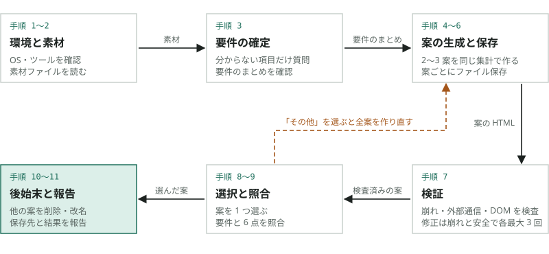
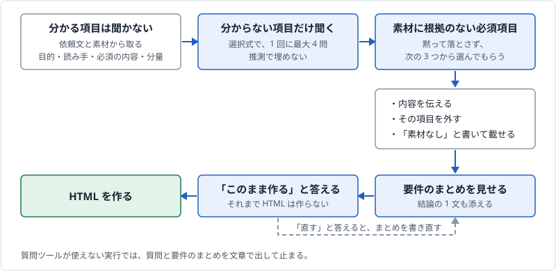

# html-report

依頼と素材ファイルから、デザインされた HTML レポートを 1 ファイルで作る Claude Code プラグイン。CSV やメモをもとに、読み手に合わせたレポートを作りたい人向け。

```
/html-report:create 先月の売上 CSV（C:\data\sales.csv）を、経営会議向けのレポートにして
```


## 機能

外部の CDN・Web フォント・画像を読み込まないので、作ったレポートはファイル単体で開ける。

| 項目 | できること | できないこと |
|---|---|---|
| 出力 | 1 ファイルで完結する HTML を作る。 | PDF・PowerPoint の生成、既存 HTML の編集、完成後の修正支援。 |
| 表示 | PC の画面（幅 1280px）で読める形にする。 | スマートフォン表示と印刷。 |
| 構成 | 縦に続く 1 つのレポートを作る。 | 複数ページのサイトとフォーム送信。 |
| 大きな CSV | 1000 行超は、集計・要約を載せる。 | 1000 行超の全件掲載。 |

スキルは 2 つ。

- `/html-report:create`: レポートを作る。11 の手順で進む。
- `/html-report:doctor`: 環境を点検する。何も変更しない（Playwright がファイルを作ることはある）。`[NG]` の次の行に対処が出る。

## 導入方法

次がそろっていること。

- Windows 11（Windows 専用）、Claude Code（動作確認は 2.1.328）
- Playwright MCP（ブラウザを操作して、作った HTML を確かめる部品。手順 2 で入れる）
- Node.js 20 以上（動作確認は 24.13.1）、Chrome または Edge
- ネットワーク接続（Playwright MCP の取得と、`/html-report:doctor` の最新バージョンの確認に使う）
- `artifact-design` スキル（Claude Code に同梱。`/skills` の一覧にあること）
- 任意: Python 3（1000 行超の CSV の集計）、`dataviz`・`artifact-diagramming` スキル（グラフと図の指針）、Git（オフライン導入の clone）

### 1. プラグインを入れる

Claude Code の中で実行する。

```
/plugin marketplace add asama0101/html-report
/plugin install html-report@html-report
```

### 2. Playwright MCP を入れる

注意: `playwright` がすでに登録されていると、「already exists」で失敗する。先に `claude mcp list` で、`playwright` の行に `--allow-unrestricted-file-access` があるか確かめる。あれば、この手順は要らない。フラグなしで登録済みなら、先に次のコマンドで登録を外してから、下のコマンドを実行する。

> **警告:** `playwright` の登録が消える。下の `claude mcp add` で登録し直せば戻る。ほかの引数を付けていたときは、先に `claude mcp list` の行を控える。

```
claude mcp remove -s user playwright
```

シェルで実行し、Claude Code を再起動する。`--allow-unrestricted-file-access` は、作った HTML を `file://` で開くために必要。Edge だけのときは、末尾に `--browser msedge` を足す。

```
claude mcp add -s user playwright -- npx @playwright/mcp@latest --allow-unrestricted-file-access
```

### 3. 環境を点検する

```
/html-report:doctor
```

### 更新

`/html-report:doctor` が新しい版を知らせたら、次を実行して、Claude Code を開き直す。

```
/plugin marketplace update html-report
/plugin update html-report@html-report
```

## 使い方

依頼文に目的と素材のパスを書くと、レポートが 1 つ保存される。`create` は、次の図の順に進む。

注意: 最後の段階で、選ばなかった案のファイルが削除される。削除したファイルは元に戻せないので、残したい案は、選ぶ前に別の場所へコピーする。



要件の確定では、分からない項目だけを聞く。



検証では、保存した全案を開いて確かめる。


「その他」で伝えると全案を作り直すが、これは初版の選び直しで、完成後の修正支援ではない。終わると、次の形で完了報告が出る。

```
保存先: C:\work\2026-11-10-先月の売上.html
選んだ案: 紺と白の落ち着いた案（全 3 案）。
要件との照合: 必須の内容 3 件をすべて載せた。分量は、指定 2 画面に対して 2.4 画面。
```

素材の内容（機密情報を含む）は HTML にそのまま入る。共有する前に確かめる。

## 困ったとき

### 「使えないもの」が伝えられ、HTML が作られない
OS・Playwright MCP・`artifact-design` のどれかが使えない。`/html-report:doctor` を実行し、`→` の行に従う。

### 検証で、保存した HTML を `file://` で開けず止まる
`claude mcp list` で、`playwright` の行に `--allow-unrestricted-file-access` があるか確かめる。なければ、導入方法の手順 2 をやり直す。

### 検証で、ページの読み込みが 30 秒で終わらず止まる
HTML は保存済み。ブラウザで直接開いて確かめる。

## ライセンス

[MIT License](LICENSE)
